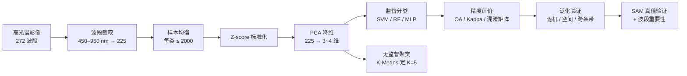

# 高光谱遥感影像语义分割 · 机器学习与深度学习实践

基于无人机 **Nano-Hyperspec 推扫式高光谱影像**（400–1000 nm，272 波段）的校园地物**逐像素分类**，
本质是一个**语义分割**任务：给影像中每一个像素都分配一个地物类别标签。

本项目完整实践了一条高光谱语义分割的**机器学习 / 深度学习**流程：

> 人工标注 → 数据预处理 → 无监督聚类（定类别数）→ 监督分类（**SVM / 随机森林 / MLP** 三模型对比）
> → 随机 / 空间 / 跨条带三种泛化验证 → 地面实测光谱 SAM 真值验证 → 波段重要性机理分析。

> 方法属于**逐像素分类范式**——每个像素用其 272 波段光谱曲线独立分类，由经典机器学习（SVM、随机森林）
> 和浅层神经网络（MLP）实现，而非 CNN/U-Net 式的深度分割网络。

---

## 一、任务定义

| 项 | 说明 |
|---|---|
| 任务类型 | 语义分割（dense prediction / 逐像素分类） |
| 输入 | 高光谱影像：每个像素是一条 272 波段的光谱曲线（400–1000 nm） |
| 输出 | 与影像同尺寸的类别图，每个像素一个类别标签 |
| 类别 | 水体/阴影、草地、树木、建筑、道路（5 类） |

## 二、数据

| 项 | 内容 |
|---|---|
| 传感器 | 无人机 Nano-Hyperspec（推扫式高光谱成像仪） |
| 光谱范围 | 400–1000 nm，共 272 波段 |
| 波段裁剪 | 截取 450–950 nm（225 波段），去掉两端低信噪比波段 |
| 训练样本 | 单条带 518,385 个标注像素 → 每类均衡至 2000，共 10,000 |
| 真值 | 地面实测光谱（ASD 光谱仪），用于 SAM 光谱角交叉验证 |

> ⚠️ 原始高光谱影像（约 18 GB）与训练集 `.npy` **未包含在本仓库**，因此代码**无法直接运行**，
> 仅作算法与流程参考。如需复现，请向项目成员获取数据。

## 三、方法流水线

1. **预处理**：波段截取（272→225）→ 类别均衡（每类最多 2000）→ Z-score 标准化 → PCA 降维（保留 99% 方差，225 维 → 3~4 个主成分）。
2. **任务一 · 无监督聚类**：`MiniBatchKMeans` + SSE 肘部法则 / Calinski-Harabasz 指数，确定类别数 K=5、探索地物可分性。
3. **任务二 · 监督分类**：在同一套预处理特征上对比三种分类器。
4. **验证与机理**：随机 / 空间 / 跨条带三种划分评估泛化能力，SAM 光谱角做真值验证，RF 波段重要性做机理分析。

### 三种监督模型

| 模型 | 类型 | 核心思想 | 关键配置 |
|---|---|---|---|
| **SVM** | 机器学习 | 最大间隔超平面 + RBF 核 | `SVC(kernel='rbf', C=10, gamma='scale')` |
| **随机森林 RF** | 机器学习（集成） | 300 棵决策树：bootstrap 抽样本 + 随机抽特征 + 投票 | `RandomForestClassifier(n_estimators=300)` |
| **MLP** | 深度学习（浅层网络） | 两层全连接 + ReLU + softmax，交叉熵 + Adam 反向传播 | `MLPClassifier(hidden_layer_sizes=(128,64), early_stopping=True)` |

## 四、结果

条带内精度（随机 70/30 划分）：

| 模型 | OA（总体精度） | Kappa |
|---|---|---|
| **随机森林 RF** | **80.6%** | **0.758** |
| MLP | 79.1% | 0.739 |
| SVM | 76.4% | 0.705 |

- **跨条带泛化**（训练条带 → 测试条带）：raw_10096 → 69.2%，raw_5232 → 71.4%
- **关键波段**（RF 重要性）：近红外 750–950 nm（33.9%）+ 蓝 450–500 nm（23.4%）
- **SAM 真值验证**：树木类 5/5 强吻合（平均 ~7.6°）

**结论**：本任务上随机森林最优——高光谱波段高度冗余、类间光谱有重叠，RF 的"集成 + 随机"机制最鲁棒；
SVM 对参数敏感；MLP 因样本量有限、特征已被 PCA 降维，优势未能完全发挥。

## 五、仓库结构

| 目录 | 内容 |
|---|---|
| `交付成果/代码/` | 按 01–06 流程组织的完整代码 |
| `交付成果/报告/` | 算法原理详解、实验报告、标注说明等 |
| `交付成果/结果图/` | 分类图、聚类图、平均光谱、波段重要性、SAM 验证图 |
| `交付成果/三种算法代码/` | 三模型核心实现（供快速理解） |
| `实测光谱/` | 地面实测光谱数据与 DataViewer 说明 |
| `DSM/` `KML Files/` | 数字表面模型与航拍航线 |

## 六、如何读懂这份代码

原始数据不在仓库中，代码**不能直接运行**，建议按以下顺序阅读：

1. **先看算法原理**：[`交付成果/报告/算法原理详解.md`](交付成果/报告/算法原理详解.md) —— 逐条拆解 SVM / RF / MLP 做了什么、为什么这样做、结果为何如此。
2. **再看流程组织**：[`交付成果/代码/README.md`](交付成果/代码/README.md) —— 代码按「01 导出标注图 → 02 标注转数据集 → 03 聚类 → 04 分类 → 05 验证 → 06 报告」六步组织。
3. **三模型核心实现**：[`交付成果/三种算法代码/README.md`](交付成果/三种算法代码/README.md) + [`交付成果/代码/04_任务二_分类/train_classify.py`](交付成果/代码/04_任务二_分类/train_classify.py) 的 `fit_eval` 函数。
